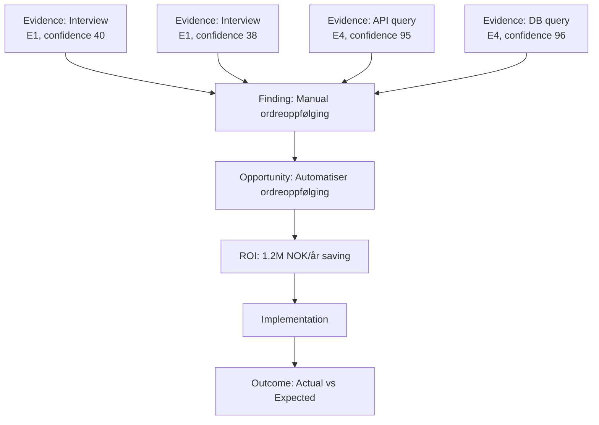

# Arch Audit Evidence Model

**Dato:** 2026-08-20  
**Versjon:** 1.0  
**Basert på:** ARCH_AUDIT_DATA_MODEL.md §4 + Master Implementation Directive §21-23, §35-37

---

## 1. Evidence Første Prinsipp

> **Evidence er first-class data. Ikke gjem evidens i fritekst.**

Hvert auditfunn **MÅ** kunne spores til kilde(r). Ingen viktige anbefalinger uten sporbarhet.

---

## 2. Evidence Livssyklus

```
CAPTURED → VALIDATED → CLASSIFIED (E0-E4) → LINKED → USED IN FINDING → ARCHIVED
    │           │             │              │           │              │
    ▼           ▼             ▼              ▼           ▼              ▼
  Raw data   Schema +     Kalibrert      evidence_    finding.evidence  Immutable
  + hash     format chk   confidence     ids[]       ids[]             storage
```

### 2.1 Capture (Inngang) — Multimodal Input

> **Alle inputtyper konverteres til samme canonical Evidence/Process/Task-modell.** Uavhengig av modalitet lander alt i én graf.

| Modalitet | Kilde | Metode | Validering |
|-----------|-------|--------|------------|
| **TEXT** | Chat-intervju | QuestionDecision → Evidence (INTERVIEW) | Schema + interview metadata |
| **VOICE** | Taleopptak | ASR → tekst → Evidence (INTERVIEW) | ASR confidence, schema |
| **DOCUMENT** | Opplasting | Parsing → hash → Evidence (DOCUMENT) | Type, størrelse, malware-scan |
| **SCREENSHOT** | Opplasting | Hash → Evidence (SCREENSHOT) | Format, størrelse |
| **SYSTEM CONNECTOR** | API/DB/Event log | Query → resultater + hash → Evidence (API/DATABASE/EVENT_LOG) | Schema, rows, latency |
| INTERVIEW | Adaptive spørsmål, opptak (valgfri) | Schema + interview metadata | Schema |
| API | Eksplicit query → response + hash | Schema, rows, latency | Schema |
| DATABASE | Eksplicit query → resultater + hash | Rows, kolonner, latency | Rows |
| EVENT_LOG | Tidsrom + aggregasjon → hash | Time range, count | Time range |
| METRIC | Query → verdi + hash | Verdi, enhet, tidsstempel | Verdi |
| OBSERVATION | Manual registrering + hash | Observer, kontekst | Observer |
| USER_CONFIRMATION | Bekreftelse på funn + hash | Hva bekreftes, av hvem | Bekreftelse |
| SYSTEM_VERIFICATION | Forventet vs faktisk + hash | Diff, match/mismatch | Diff |

**Canonical mapping (all modalitet → Evidence):**
```typescript
function toCanonicalEvidence(input: MultimodalInput): Evidence {
  // Uavhengig av input.modality, blir resultatet:
  return {
    id: uuid(),
    source_type: modalityToSourceType(input.modality),  // TEXT→INTERVIEW, VOICE→INTERVIEW, DOCUMENT→DOCUMENT, SCREENSHOT→SCREENSHOT, SYSTEM_CONNECTOR→API/DATABASE
    source: input.raw,
    hash: input.hash,
    classification: classifyEvidence(input),  // E0-E4 basert på modalitet + verifisering
    captured_at: input.captured_at,
    // ...
  };
}

### 2.2 Validation (Validering)

```typescript
function validateEvidence(evidence: EvidenceInput): ValidationResult {
  const errors: string[] = [];
  
  // 1. Hash matcher innhold
  if (evidence.hash !== sha256(evidence.rawContent)) {
    errors.push("Hash mismatch");
  }
  
  // 2. Påkrevde felt
  if (!evidence.source_type || !evidence.source || !evidence.captured_at) {
    errors.push("Missing required fields");
  }
  
  // 3. Tenant scope
  if (evidence.tenant_id !== currentTenantId) {
    errors.push("Tenant mismatch");
  }
  
  // 4. Classification gyldig
  if (!["E0", "E1", "E2", "E3", "E4"].includes(evidence.classification)) {
    errors.push("Invalid classification");
  }
  
  // 5. Confidence kalibrert
  if (evidence.confidence < 0 || evidence.confidence > 100) {
    errors.push("Confidence out of range");
  }
  
  // 6. Temporal consistency
  if (evidence.valid_to && evidence.valid_from && 
      evidence.valid_to < evidence.valid_from) {
    errors.push("Invalid temporal range");
  }
  
  return { valid: errors.length === 0, errors };
}
```

---

## 3. Evidence Strength (E0–E4) — §23

| Klasse | Navn | Definisjon | Min. Confidence | Vekt i ROI | Eksempler |
|--------|------|------------|-----------------|------------|-----------|
| **E0** | UNSUPPORTED | Påstand uten evidens | 0 | 0.0 | "Vi tror prosessen er treg" |
| **E1** | ANECDOTAL | Én menneskelig kilde | 35 | 0.2 | Intervju: "Jeg bruker 15 min" |
| **E2** | CORROBORATED | Flere uavhengige menneskelige kilder | 55 | 0.4 | 3 intervjuer sier det samme |
| **E3** | OBSERVED | Direkte observasjon (skjermbilde, recording) | 75 | 0.7 | Screen recording av prosess |
| **E4** | SYSTEM_VERIFIED | Maskinverifisert (DB, API, logg) | 95 | 1.0 | `SELECT COUNT(*) FROM orders` |

### 3.1 Regler for Oppgradering

```
E0 → E1:   Legg til interview kilde
E1 → E2:   Legg til ≥2 uavhengige menneskelige kilder
E2 → E3:   Legg til direkte observasjon (skjermbilde/opptak)
E3 → E4:   Erstatt med system-query (DB/API/logg) som gir samme resultat
```

**VIKTIG:** LLM-en skal **ALDRI** selv oppgradere evidensnivå uten eksplisitt ny evidens.

---

## 4. Evidence Graph (§35)



### 4.2 Graph Traversering

```typescript
// Fra funn → alle støttende evidens
async function getEvidenceChain(findingId: string): Promise<Evidence[]> {
  const finding = await db.findings.get(findingId);
  return Promise.all(finding.evidence_ids.map(id => db.evidence.get(id)));
}

// Fra evidens → alle funn den støtter
async function getFindingsFromEvidence(evidenceId: string): Promise<Finding[]> {
  return db.findings.query({ evidence_ids_contains: evidenceId });
}

// Fra funn → mulighet → ROI
async function getOpportunityChain(findingId: string): Promise<Opportunity[]> {
  return db.opportunities.query({ finding_id: findingId });
}
```

---

## 5. Contradiction Detection (§21)

> «Prosessen beskrives slik, men systemdata viser noe annet.»

### 5.1 Contradiction Types

| Type | Beskrivelse | Eksempel |
|------|-------------|----------|
| **INTERVIEW_VS_SYSTEM** | Menneskelig oppgavebeskrivelse ≠ systemdata | Intervju: "15 min" → DB: 47 min |
| **INTERVIEW_VS_INTERVIEW** | To intervjuer sier ulikt | Avd A: "Vi bruker systemet" → Avd B: "Vi bruker Excel" |
| **SYSTEM_VS_SYSTEM** | To systemer viser ulikt | CRM: 1000 kunder → ERP: 1200 kunder |
| **DOCUMENT_VS_SYSTEM** | Dokumentasjon ≠ realitet | Prosessdok: "Automatisk" → Logg: "Manuell" |
| **TEMPORAL_DRIFT** | Evidens har utløpt | "Vi bruker systemet" → Systemet er deprecated |

### 5.2 Deteksjonsalgoritme

```typescript
async function detectContradictions(auditId: string): Promise<Contradiction[]> {
  const contradictions: Contradiction[] = [];
  const findings = await db.findings.query({ audit_id: auditId });
  
  for (const finding of findings) {
    const evidence = await getEvidenceChain(finding.id);
    
    // Grupper etter kilde-type
    const bySource = groupBy(evidence, e => e.source_type);
    
    // INTERVIEW vs SYSTEM_VERIFIED
    if (bySource.INTERVIEW && bySource.SYSTEM_VERIFIED) {
      for (const interview of bySource.INTERVIEW) {
        for (const system of bySource.SYSTEM_VERIFIED) {
          if (coversSameClaim(interview, system)) {
            const diff = quantifyDifference(interview, system);
            if (diff.significance > THRESHOLD) {
              contradictions.push({
                type: "INTERVIEW_VS_SYSTEM",
                finding_id: finding.id,
                evidence_a: interview.id,
                evidence_b: system.id,
                claim: extractClaim(interview),
                interview_value: extractValue(interview),
                system_value: extractValue(system),
                difference_pct: diff.percent,
                severity: diff.significance > 0.5 ? "HIGH" : "MEDIUM",
                detected_at: new Date().toISOString()
              });
            }
          }
        }
      }
    }
    
    // INTERVIEW vs INTERVIEW (forskjellige kilder)
    if (bySource.INTERVIEW && bySource.INTERVIEW.length >= 2) {
      // Sjekk for uenighet
    }
  }
  
  return contradictions;
}
```

### 5.3 Håndtering av Kontradiksjoner

| Alvorlighet | Handling |
|-------------|----------|
| **HIGH** | Blokker funn-verifisering, krev menneskelig gjennomgang, flagg i rapport |
| **MEDIUM** | Merk funn som "CONFLICTING_EVIDENCE", reduser confidence, anbefal verifisering |
| **LOW** | Logg, fortsett med laveste confidence |

---

## 6. Evidence Decay (§36)

Data endrer seg over tid. Evidence må ha temporal validitet.

```typescript
interface EvidenceTemporal {
  captured_at: string;           // Når ble det fanget
  valid_from: string;            // Fra når er det gyldig
  valid_to?: string;             // Til når (hvis kjent)
  superseded_at?: string;        // Når ble det erstattet
  superseded_by?: string;        // Evidence ID som erstattet
  decay_rate_pct_per_year?: number; // For menschlichen kilder
}

/*
Eksempel decay rates:
- SYSTEM_VERIFIED: 0% per år (mens systemet ikke endres)
- OBSERVED: 5% per år (prosesser endres)
- CORROBORATED: 10% per år (mennesker glemmer/endrer praksis)
- ANECDOTAL: 20% per år (høyeste usikkerhet)
*/

function calculateCurrentConfidence(evidence: Evidence): number {
  const yearsSinceCapture = (Date.now() - new Date(evidence.captured_at).getTime()) / (1000*60*60*24*365);
  const decayRate = evidence.metadata.decay_rate_pct_per_year ?? 
    (evidence.classification === "E4" ? 0 : 
     evidence.classification === "E3" ? 5 :
     evidence.classification === "E2" ? 10 : 20);
  
  const decayed = evidence.confidence * Math.max(0, 1 - (yearsSinceCapture * decayRate / 100));
  return Math.round(Math.max(0, decayed));
}
```

---

## 7. Decision Trace (§37)

For viktige beslutninger registrer fullsporbarhet:

```typescript
interface DecisionTrace {
  id: string;
  audit_id: string;
  tenant_id: string;
  decision_point: string;        // "OPPORTUNITY_PRIORITIZATION", "AUTONOMY_ASSIGNMENT", "HUMAN_GATE"
  
  // WHO/WHAT
  actor: { type: "AGENT" | "HUMAN" | "POLICY"; id: string; };
  action: string;                // "ASSIGN_A3_AUTONOMY", "APPROVE_FINDING", "REJECT_OPPORTUNITY"
  
  // CONTEXT
  context: DecisionContext;
  
  // EVIDENCE
  evidence_ids: string[];
  evidence_summary: string;      // "E4 system data + E2 interviews"
  
  // POLICY
  policy_rules_applied: string[]; // ["POL-AUTONOMY-RISK-HIGH", "POL-HUMAN-GATE-FINANCIAL"]
  policy_version: string;
  
  // DECISION
  decision: string;              // "ASSIGNED_A2_DRAFT", "REQUIRED_HUMAN_APPROVAL"
  rationale: string;             // "High financial risk + E2 evidence → A3 required"
  
  // ACTION
  action_taken: string;          // "OPPORTUNITY_MOVED_TO_NEXT"
  
  // RESULT
  result: DecisionResult;
  
  // EVALUATION (etterpå)
  evaluated_at?: string;
  outcome_match?: boolean;       // Matchet beslutningen realiteten?
  lessons?: string[];
  
  created_at: string;
}

interface DecisionContext {
  risk_level: RiskLevel;
  evidence_class: EvidenceClass;
  financial_exposure: number;
  reversibility: "FULL" | "PARTIAL" | "NONE";
  autonomy_requested: AutonomyLevel;
  phase: AuditState;
}
```

### 7.1 Reproduksjon

```typescript
// Gitt en decision_trace, kan vi reproducere beslutningen
async function reproduceDecision(traceId: string): Promise<ReproductionResult> {
  const trace = await db.decision_traces.get(traceId);
  const evidence = await Promise.all(trace.evidence_ids.map(id => db.evidence.get(id)));
  const policy = await db.policies.get(trace.policy_version);
  
  // Kjør samme policy evaluering
  const decision = await policyEngine.evaluate({
    principal: trace.actor,
    action: trace.action,
    resource: trace.context.resource,
    context: trace.context,
    evidence: evidence
  });
  
  return {
    original_decision: trace.decision,
    reproduced_decision: decision.decision,
    matches: decision.decision === trace.decision,
    differences: decision.decision !== trace.decision ? explainDiff(trace.decision, decision) : []
  };
}
```

---

## 8. Evidence Quality Metrics (per audit)

```typescript
interface EvidenceQualityMetrics {
  audit_id: string;
  
  // Dekning
  total_evidence_items: number;
  evidence_per_finding: number;        // Gjennomsnitt
  findings_with_evidence_pct: number;  // Bør være 100%
  findings_with_E4_pct: number;        // Mål: > 50%
  findings_with_only_E0_E1_pct: number; // Mål: < 10%
  
  // Kvalitet
  avg_confidence: number;
  calibrated_confidence: number;       // Etter decay-korreksjon
  contradiction_count: number;
  high_severity_contradictions: number;
  
  // Provenance
  system_verified_pct: number;         // E4 andel
  interview_pct: number;
  document_pct: number;
  observation_pct: number;
  
  // Sporbarhet
  findings_with_full_trace_pct: number; // Funn → evidens → kilde
  decision_traces_count: number;
  
  // Score
  evidence_quality_score: number;      // 0-100 sammensatt
}
```

**Mål for world-class:**
- `findings_with_evidence_pct`: 100%
- `findings_with_E4_pct`: > 60%
- `findings_with_only_E0_E1_pct`: < 5%
- `contradiction_count`: 0 HIGH
- `evidence_quality_score`: > 85

---

## 9. Evidence Ingestion Pipeline

```typescript
// Alle evidens går gjennom samme pipeline
async function ingestEvidence(input: EvidenceInput, context: IngestionContext): Promise<Evidence> {
  // 1. Valider input
  const validation = validateEvidence(input);
  if (!validation.valid) throw new Error(validation.errors.join(", "));
  
  // 2. Generer hash
  const hash = sha256(JSON.stringify(input.rawContent));
  
  // 3. Sjekk duplikat (samme hash = samme evidens)
  const existing = await db.evidence.findByHash(hash);
  if (existing) return existing; // Idempotent
  
  // 4. Klassifiser (hvis ikke angitt)
  const classification = input.classification ?? inferClassification(input);
  
  // 5. Kalibrer confidence
  const confidence = calibrateConfidence(input.llmConfidence ?? 50, classification);
  
  // 6. Temporal
  const now = new Date().toISOString();
  const validFrom = input.valid_from ?? now;
  
  // 7. Lagre
  const evidence: Evidence = {
    id: uuid(),
    tenant_id: context.tenantId,
    audit_id: context.auditId,
    source_type: input.source_type,
    source: input.source,
    captured_at: now,
    valid_from: validFrom,
    valid_to: input.valid_to,
    hash,
    classification,
    confidence,
    process_id: input.process_id,
    task_id: input.task_id,
    finding_id: input.finding_id,
    metadata: {
      ...input.metadata,
      collected_by: context.actorId,
      collection_method: input.source_type,
      raw_data_ref: await storeRawData(input.rawContent) // R2
    },
    access_policy: {
      classification: input.privacyClass ?? "CONFIDENTIAL",
      allowed_roles: ["ANALYST", "ADMIN", "OWNER"],
      tenant_scoped: true,
      retention_days: 365,
      encryption_required: input.privacyClass === "RESTRICTED"
    }
  };
  
  await db.evidence.insert(evidence);
  
  // 8. Oppdater funn hvis knyttet
  if (evidence.finding_id) {
    await db.findings.addEvidence(evidence.finding_id, evidence.id);
    await recalculateFindingConfidence(evidence.finding_id);
  }
  
  // 9. Audit log
  await db.audit_log.insert({
    audit_id: context.auditId,
    action: "EVIDENCE_INGESTED",
    entity_type: "EVIDENCE",
    entity_id: evidence.id,
    actor: context.actorId,
    timestamp: now,
    metadata: { classification, confidence }
  });
  
  return evidence;
}
```

---

## 10. Evidence Retention & Deletion

| Klassifisering | Retensjon | Kryptering | Sletting |
|----------------|-----------|------------|----------|
| PUBLIC | 7 år | Valgfri | Standard |
| INTERNAL | 7 år | Valgfri | Standard |
| CONFIDENTIAL | 7 år | Påkrevd | Standard |
| RESTRICTED | 3 år | Påkrevd (AES-256) | Sikker sletting (crypto-shred) |

**GDPR-rettigheter:**
- Eksport: Alle evidence for en tenant (uten raw PII i metadata)
- Sletting: Crypto-shred (slett krypteringsnøkkel) for RESTRICTED
- Rettighetsforespørsel: Logg i `audit_log`

---

## 11. Evidence API

| Endepunkt | Metode | Beskrivelse | Policy |
|-----------|--------|-------------|--------|
| `/api/audits/:id/evidence` | GET | List evidence for audit | `evidence.read` |
| `/api/audits/:id/evidence` | POST | Ingest ny evidence | `evidence.write` |
| `/api/audits/:id/evidence/:eid` | GET | Hent evidence detaljer | `evidence.read` |
| `/api/audits/:id/evidence/:eid` | PATCH | Oppdater metadata (IKKE innhold/hash) | `evidence.write` |
| `/api/audits/:id/evidence/:eid/verify` | POST | System-verifiser eksisterende evidence | `evidence.verify` |
| `/api/audits/:id/evidence/bulk` | POST | Bulk ingest (intervjuer, dokumenter) | `evidence.write` |
| `/api/audits/:id/evidence/graph` | GET | Evidence graph (funn → evidens) | `evidence.read` |
| `/api/audits/:id/contradictions` | GET | Detekterte kontradiksjoner | `evidence.read` |

---

## 12. Testing

### 12.1 Golden Evidence Sets

```typescript
// Testdata for regresjonstesting
const GOLDEN_EVIDENCE = [
  {
    id: "gold-e4-db-count",
    source_type: "SYSTEM_VERIFIED",
    classification: "E4",
    expected_confidence: 95,
    test: "DB query returns exact count"
  },
  {
    id: "gold-e1-interview",
    source_type: "INTERVIEW",
    classification: "E1",
    expected_confidence: 35,
    test: "Single interview claim"
  },
  {
    id: "gold-contradiction",
    source_type: "INTERVIEW",
    classification: "E1",
    contradicts: "gold-e4-db-count",
    expected_severity: "HIGH",
    test: "Interview claims 15 min, DB shows 47 min"
  }
];
```

### 12.2 Evidence Quality Tests

```typescript
describe("Evidence Quality", () => {
  test("E4 evidence gets weight 1.0 in ROI", () => {
    expect(EVIDENCE_CALIBRATION.E4.weight).toBe(1.0);
  });
  
  test("Contradiction detected when interview ≠ system", async () => {
    const audit = await createTestAudit({
      interview: "15 min per ordre",
      dbQuery: "47 min per ordre"
    });
    const contradictions = await detectContradictions(audit.id);
    expect(contradictions.some(c => c.severity === "HIGH")).toBe(true);
  });
  
  test("Evidence decay reduces confidence over time", () => {
    const oldEvidence = createEvidence({ 
      classification: "E1", 
      confidence: 40, 
      captured_at: "2020-01-01" 
    });
    const current = calculateCurrentConfidence(oldEvidence);
    expect(current).toBeLessThan(40);
  });
});
```

---

## 13. Sammendrag: Evidence Sjekkliste per Audit

| Sjekk | Mål | Verifiseres ved |
|-------|-----|-----------------|
| Alle funn har evidens | 100% | `findings_with_evidence_pct` |
| E4 andel | > 60% | `findings_with_E4_pct` |
| E0/E1 only funn | < 5% | `findings_with_only_E0_E1_pct` |
| Kontradiksjoner | 0 HIGH | `high_severity_contradictions` |
| Sporbarhet | 100% | `findings_with_full_trace_pct` |
| Confidence kalibrert | Ja | `calibrated_confidence` |
| Temporal gyldighet | Ja | `valid_to` sjekk |
| Hash integritet | Ja | `hash === sha256(content)` |

Dette er **minimumskrav** for at en audit skal kunne leveres til kunde.